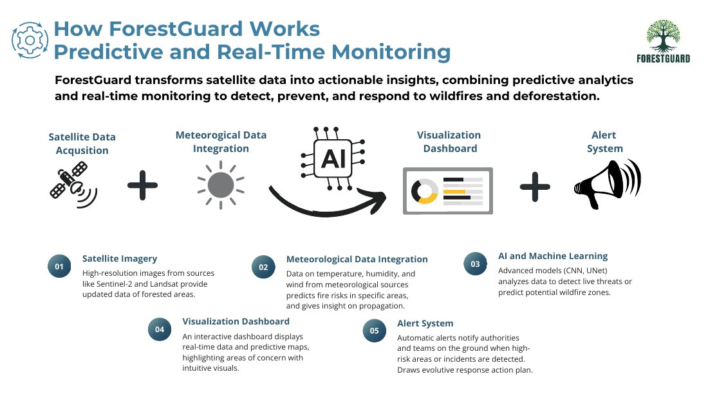
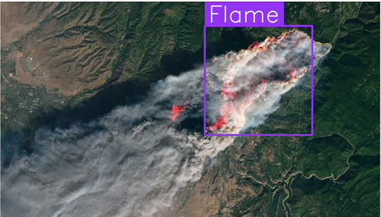
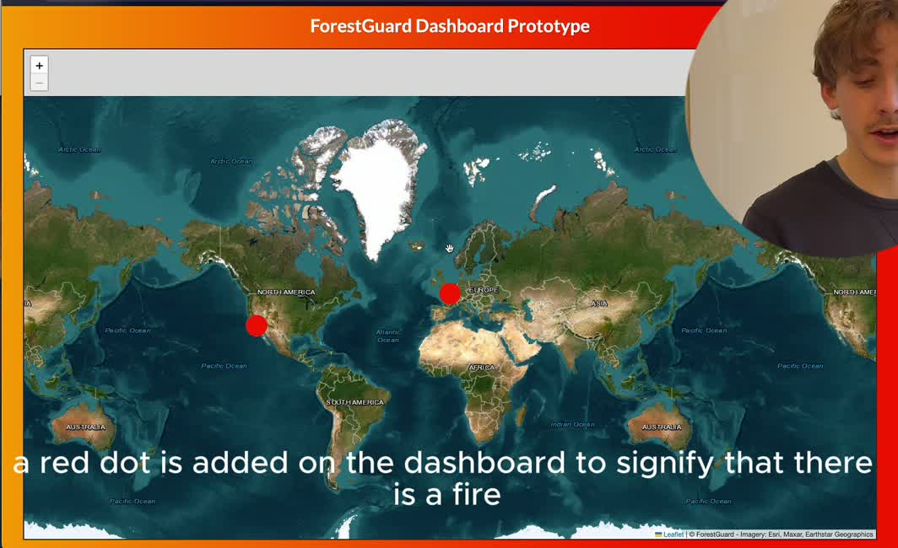

# ForestGuard

**A student prototype exploring computer vision and mapping for forest-fire monitoring.**

Built for **AVEVA EcoTech Emerge**, where our team reached the **top 10**.



## The prototype

Two small, independent components demonstrate the idea:

- **Image detection:** select an image file or URL, call a hosted Roboflow model, and display annotated detections.
- **Map dashboard:** add coordinates and a message from a Python interface to a Leaflet map through Eel.

The research and pitch explored a broader system combining satellite imagery, weather, and risk prediction. This repository contains the original proof of concept: **it does not implement that complete pipeline**, train a new model, or automatically locate an image detection on the map.

## From the original demonstration





These are frames extracted from the team's January 2025 project video, rather than a new benchmark. [Watch a short detection excerpt](docs/demo-detection.mp4). The concept image comes from our original presentation and describes the proposed architecture.

## Run locally

The original prototype used Python 3.12, Tkinter, and Chrome for the Eel window.

```bash
python3.12 -m venv .venv
source .venv/bin/activate
pip install -r requirements.txt
export ROBOFLOW_API_KEY="your-own-key"
python detector.py
```

The detector uses the original hosted model ID. Availability and model access depend on the service and your own credentials. There are no bundled model weights or training data.

For the independent map demo:

```bash
cd dashboard
python main.py
```

Internet access is needed for inference and map assets. The Paris and Los Angeles markers are demonstration coordinates, not live incidents. `experiments/webcam.py` is a separate generic object-detection experiment, not a trained wildfire webcam detector.

## Team and archive notes

Mathieu Gautier, Daouda Keita, and Farhan Zaveri, CentraleSupelec. This is a team project, not a claim of sole authorship.

The public copy preserves the prototype's application behavior. Packaging adds documentation, dependency names, and extracts from the existing presentation/video. The embedded API key was replaced with an environment-variable lookup. Unrelated scratch work, full decks containing contact information, and credentials are excluded.

Roboflow supplies the hosted inference/model; Eel bridges Python and JavaScript; Leaflet displays the map. Esri/Maxar/Earthstar imagery attribution is retained in the dashboard. Third-party services, model outputs, and imagery retain their respective rights. No new license is asserted over team or third-party material.
